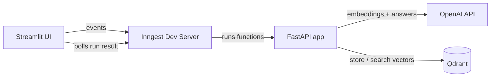

# RAG PDF App

Upload PDF documents and ask questions about them in plain language. The app finds the most relevant passages in your PDFs and uses an LLM to write an answer based only on those passages, along with the documents it came from.

This is a **RAG (Retrieval-Augmented Generation)** application. The LLM doesn't answer from memory: it answers from your documents.

## How it works

The app has two workflows.

### 1. Ingest a PDF

```
Upload PDF ─▶ Read text ─▶ Split into chunks ─▶ Create embeddings ─▶ Store in Qdrant
```

1. You upload a PDF in the Streamlit UI.
2. The app sends an event (`rag/ingest_pdf`) to Inngest.
3. Inngest runs the ingestion function, which:
   - reads the PDF and extracts its text
   - splits the text into overlapping chunks (1000 tokens, 200 overlap)
   - turns each chunk into a vector (embedding) with OpenAI
   - saves the vectors and the original text in the Qdrant vector database

### 2. Ask a question

```
Question ─▶ Embed question ─▶ Search Qdrant ─▶ Send top chunks + question to LLM ─▶ Answer + sources
```

1. You type a question in the Streamlit UI.
2. The app sends an event (`rag/query_pdf_ai`) to Inngest.
3. Inngest runs the query function, which:
   - turns the question into a vector
   - finds the most similar chunks in Qdrant (top‑k)
   - sends those chunks and the question to the LLM
   - returns the answer and the names of the source PDFs
4. The UI shows the answer and its sources.

## Architecture



## Tech stack

| Layer | Technology | Purpose |
|---|---|---|
| Language | **Python 3.13** | The whole app |
| Package manager | **uv** | Dependencies and virtual environment |
| Backend API | **FastAPI** + **Uvicorn** | Serves the Inngest functions over HTTP |
| Workflow orchestration | **Inngest** | Runs ingestion and query as event-driven workflows with steps, retries, throttling, rate limiting and a dashboard to inspect each run |
| PDF processing | **LlamaIndex** (`PDFReader`, `SentenceSplitter`) | Reads PDFs and splits text into chunks |
| Embeddings | **OpenAI** `text-embedding-3-large` | Turns text into 3072‑dimension vectors |
| LLM | **OpenAI** `gpt-4o-mini` | Writes the final answer from the retrieved context |
| Vector database | **Qdrant** (Docker) | Stores vectors and runs cosine similarity search |
| Frontend | **Streamlit** | Web UI to upload PDFs and ask questions |
| Config | **python-dotenv** | Loads API keys from `.env` |

## Project structure

```
.
├── main.py            # FastAPI app + Inngest functions (ingest & query)
├── data_loader.py     # PDF loading, chunking and embeddings
├── vector_db.py       # Qdrant wrapper (create collection, upsert, search)
├── custom_types.py    # Pydantic models for step results
├── streamlit_app.py   # Streamlit frontend
├── pyproject.toml     # Project dependencies (uv)
└── .env               # API keys (not committed)
```

## Getting started

### Prerequisites

- [uv](https://docs.astral.sh/uv/)
- [Docker](https://www.docker.com/) (for Qdrant)
- [Node.js](https://nodejs.org/) (for the Inngest dev server via `npx`)
- An OpenAI API key

### 1. Install dependencies

```bash
uv sync
```

### 2. Add your API key

Create a `.env` file in the project root:

```
OPENAI_API_KEY=your-key-here
```

### 3. Start Qdrant

```bash
docker run -d -p 6333:6333 -v ./qdrant_storage:/qdrant/storage qdrant/qdrant
```

### 4. Start the FastAPI app

```bash
uv run uvicorn main:app
```

### 5. Start the Inngest dev server

```bash
npx inngest-cli@latest dev -u http://127.0.0.1:8000/api/inngest
```

The Inngest dashboard is at http://localhost:8288.

### 6. Start the UI

```bash
uv run streamlit run streamlit_app.py
```

Open http://localhost:8501, upload a PDF and ask a question.

## Credits

Based on the [Production Grade RAG Python App](https://github.com/techwithtim/ProductionGradeRAGPythonApp) tutorial by Tech With Tim, with my own changes on top.